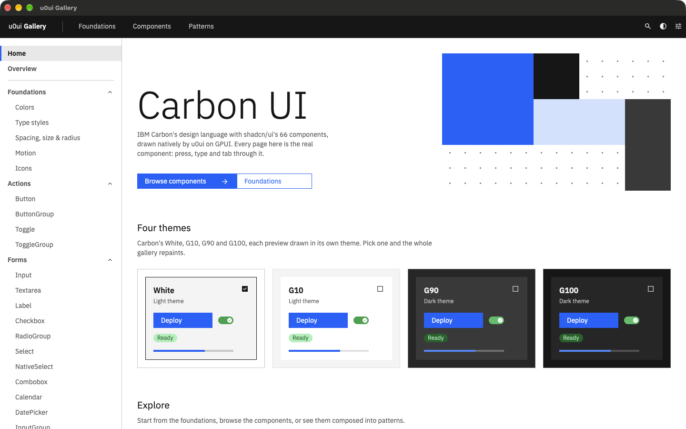
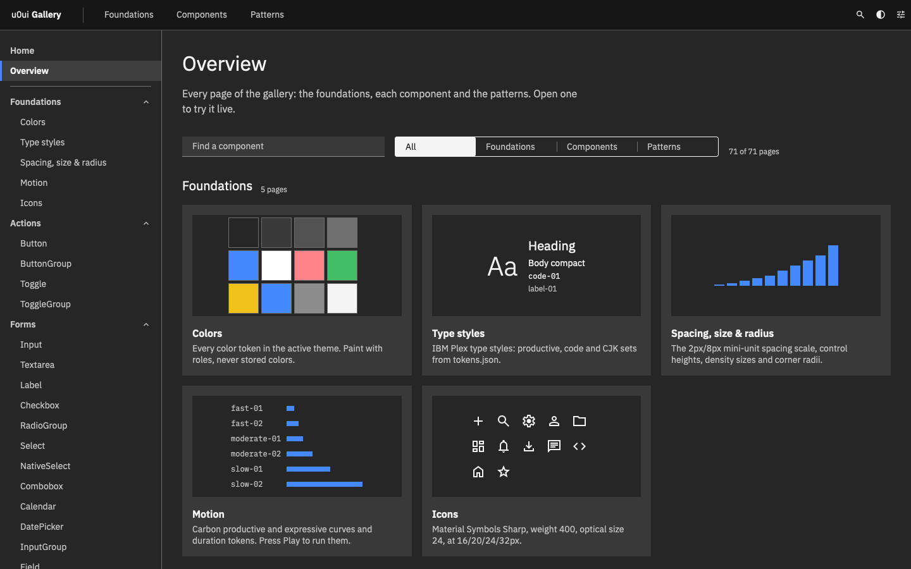
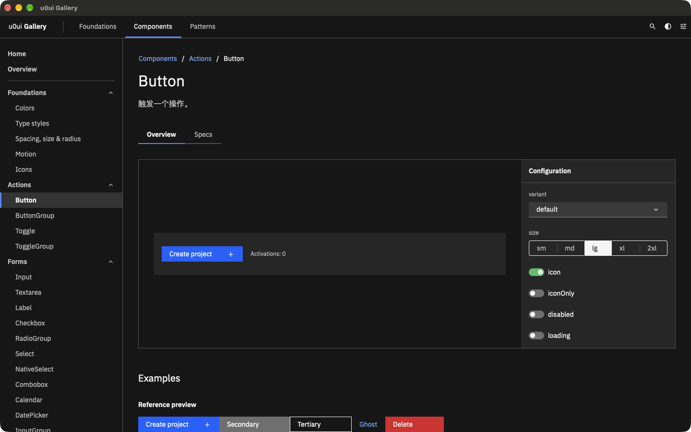

# u0ui

**English** · [简体中文](README.zh-CN.md)

Carbon UI for [GPUI](https://www.gpui.rs/): IBM **Carbon v11** visuals with a
**shadcn/ui**-style component API and **Material Symbols Sharp** icons, built on
[GPUI Kit](https://github.com/longbridge/gpui-kit) 0.11.

Buttons, fields, selects, menus, dialogs, sheets, tables, tabs, side navigation,
charts, chat bubbles and more, drawn the way `@carbon/styles` draws them: square
corners, filled fields with a bottom rule, layer tokens instead of shadows, the
2px focus ring and Carbon's productive motion. Kit owns behavior (focus, keyboard,
text editing, overlays, scrolling); u0ui owns the look.







## Features

- **Carbon v11 look**: geometry, per-state colors and motion taken from the
  compiled `@carbon/styles` CSS of the Carbon UI design reference; every token
  is generated, never hand-typed.
- **Four themes**: White, G10, G90 and G100, with Carbon's layering model
  (background → layer-01 → layer-02 → layer-03) and its contextual tokens, and
  `theme::zone` for a region in a fixed theme (an always-dark header).
- **shadcn/ui API**: the 66 shadcn components under their shadcn names
  (`Badge` is Carbon's Tag, `Card` its Tile, `Select` its Dropdown…), plus a
  Chat & AI set; builders mirror the reference `index.d.ts`.
- **Material Symbols Sharp** everywhere (weight 400, optical size 24, 16/20/24/32px),
  with Carbon's icon names kept (`CarbonIcon::Add`, `ChevronDown`, …).
- **Desktop density**: compact rows and fields by default, Carbon's comfortable
  sizes on request; sizes in `rem`, so zoom reflows.
- **Reduced motion**: movement becomes a fade, rotation a pulse, shimmer stops.
- **IBM Plex** Sans and Mono bundled, with CJK fallbacks.

## Quick start

Minimum Rust 1.98.

```toml
[dependencies]
gpui-kit = "0.11"
u0ui = { git = "https://github.com/u0-code/gpui-u0ui" }
```

Use the `gpui-kit` version u0ui depends on, so GPUI and Kit resolve to one copy.
Initialize Kit, then u0ui, and serve u0ui's icon assets:

```rust,no_run
use gpui_kit::*;
use u0ui::prelude::*;

struct Hello;

impl Render for Hello {
    fn render(&mut self, _: &mut Window, _: &mut Context<Self>) -> impl IntoElement {
        div()
            .size_full()
            .p(tokens::SPACING_07)
            // Paint with color roles, so the UI follows the theme.
            .bg(color(ColorRole::Background))
            .text_color(color(ColorRole::TextPrimary))
            .child(Button::new("deploy", "Deploy").icon(CarbonIcon::Launch))
    }
}

fn main() {
    gpui_kit::application()
        .with_assets(u0ui::Assets::new())
        .run(|cx| {
            gpui_kit::init(cx);
            u0ui::init(cx);
            gpui_kit::open_window(WindowOptions::default(), cx, |_, cx| cx.new(|_| Hello))
                .expect("open the window");
        });
}
```

[`crates/u0ui/examples/hello.rs`](crates/u0ui/examples/hello.rs) is this example
with a counter and a theme switch (`cargo run -p u0ui --example hello`); `cargo test` builds
it, so it stays true. Components are controlled or not, like shadcn's: pass
`checked`/`value`/`open` and a change handler, or a `default_*` and let the
component keep its state.

## Components

| Group | Components | Status |
| --- | --- | --- |
| Actions | Button, ButtonGroup, Toggle, ToggleGroup | Done |
| Forms | Input, Textarea, Label, Checkbox, RadioGroup, Select, NativeSelect, Combobox, Calendar, DatePicker, InputGroup, Field, InputOTP, Switch, Slider | Done |
| Data display | AspectRatio, Kbd, Separator, Badge, Card, Chart, Avatar, Table, DataTable, CodeBlock, Empty, Item, Typography | Done |
| Feedback | Spinner, Skeleton, Progress, Alert, Toast | Done |
| Navigation | Menubar, Tabs, Accordion, Collapsible, Breadcrumb, Pagination, NavigationMenu, Sidebar | Done |
| Overlays | Dialog, AlertDialog, Sheet, Drawer, Tooltip, Popover, HoverCard, DropdownMenu, ContextMenu, Command | Done |
| Layout | ScrollArea, Resizable, Direction, Carousel | Done |
| Chat & AI | Bubble, Message, Marker, MessageScroller, Attachment, Questionnaire, Trace | Done |
| Carbon · Patterns | 16 Carbon patterns (global header, forms, dialogs, empty states, …) | Planned |
| T3 · … | 92 cards from the T3 Code pattern library | Planned |
| u0 · … | 81 cards from the u0 pattern library | Planned |

"Done" means implemented with tests and shown live in the gallery; reviews
against the reference continue, so details may still change before 1.0.

## The gallery

`crates/gallery` shows every component live, in md3.io's page structure: a
landing page, an overview of every component with live thumbnails, and per
component a **Playground** (the real component beside a configuration panel of
switches, content switchers and selects for every variant, size and state), the
reference **Examples**, and for some a **Specs** tab (anatomy, measurements and
state colors read from the component's own look functions). The header has the
⌘K palette, the theme (White, G10, G90, G100) and the display settings (density,
reduced motion).

```sh
cargo run -p u0ui-gallery --release
cargo run -p u0ui-gallery --release -- --page button --theme g100 --density comfortable
# Screenshots, headless: every route, or one with --page.
cargo run -p u0ui-gallery --release -- --capture shots --theme g10 --size 1440x900
```

`--page` takes `home`, `overview`, `foundations`, `components`, `patterns` or a
component id (`--help` lists them). The screenshots above came from the
running gallery at 1440×900 (`docs/screenshots/`).

## Theming, layers and density

```rust,ignore
theme::set_theme(cx, CarbonTheme::G90);        // repaints every window, Kit included
let bg = color(ColorRole::Layer01);            // context-free role lookup
Input::new("name", &state).layer(LayerLevel::Two) // a field on a layer-01 surface
density::set_density(cx, Density::Comfortable); // Carbon's 40px fields, 48px buttons
motion::set_reduced_motion(cx, motion::ReducedMotion::Reduce);
div().child(theme::zone(CarbonTheme::G100, |_, _| header().into_any_element()))
```

- **Themes**: `set_theme` is the only write path; it also projects Carbon into
  Kit's theme so Kit inputs, lists and scrollbars match. Render never mutates it.
- **Layers**: components that paint contextual tokens take a `LayerLevel`
  (default `One`, on `background`); a container that paints `layer-0N` hands
  `level.next()` to its children.
- **Density**: `Compact` (desktop default: rows 28/32/36, fields 28/32) or
  `Comfortable` (Carbon's sizes).

## Architecture

```text
$U0UI_DESIGN_DIR (outside the repo) ──u0ui-codegen──▶ generated tokens, icons, descriptions
u0ui::tokens → theme → typography → motion → icons → density → components
crates/gallery: shell, home, overview, pages, specs, --capture
```

Kit owns behavior and u0ui draws Carbon on top: each component wraps the Kit or
Base element that already does the job and computes its look and geometry as
pure, tested functions of state, size and density. See
[docs/ARCHITECTURE.md](docs/ARCHITECTURE.md) for the layers, the key decisions
and the recipes for adding a component or a gallery page, and
[AGENTS.md](AGENTS.md) for the rules every change follows.

## The design reference

u0ui implements the **Carbon UI** design-system reference (Carbon v11 wrapped in
the shadcn/ui API; tokens, component READMEs and previews, `index.d.ts`, the
compiled `bundle.css`). It is **not in this repository**. The sources derived
from it are generated and committed, so the repo builds without it:
`crates/u0ui/src/generated/{tokens,carbon_icons}.rs` and
`crates/gallery/src/generated/descriptions.rs`. When the reference changes:

```sh
export U0UI_DESIGN_DIR=/path/to/carbon-ui-reference
cargo run -p u0ui-codegen           # regenerate
cargo run -p u0ui-codegen -- --check # fail if the committed sources are stale
```

## License

The code is Apache-2.0. Bundled and derived assets keep their licenses:

- **IBM Plex** fonts (`crates/u0ui/assets/fonts`): SIL Open Font License 1.1.
- **Material Symbols** (through `gpui-material-symbols`): Apache-2.0, Google.
- **Simple Icons** 16.37.0 brand marks (`crates/u0ui/assets/brands`): CC0-1.0,
  except Android (CC-BY-3.0) and GitHub Copilot (MIT); see its `NOTICE`. The
  marks are their owners' trademarks.
- **Carbon** design tokens and styles (`@carbon/themes`, `@carbon/styles`, from
  which the generated tokens and component values come): Apache-2.0, IBM.

u0ui is not affiliated with IBM; it uses no IBM logo or trademark.
