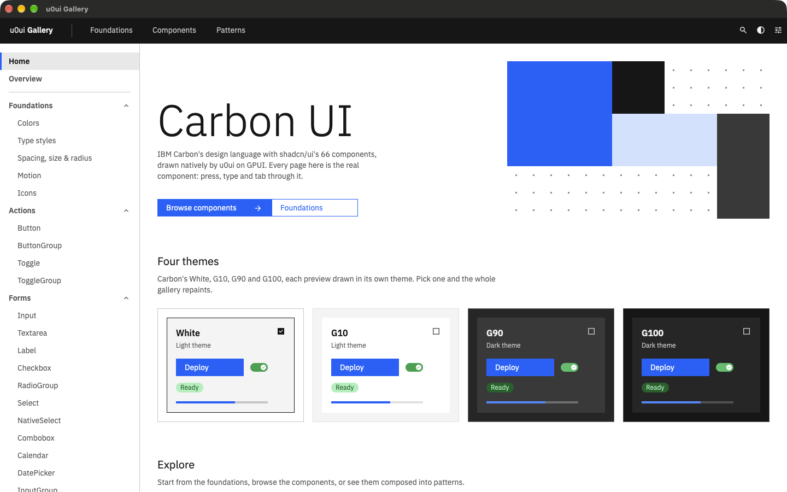
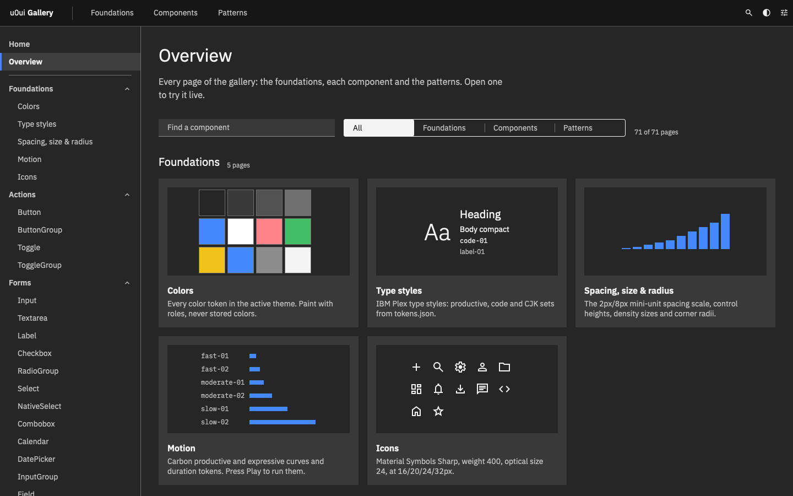
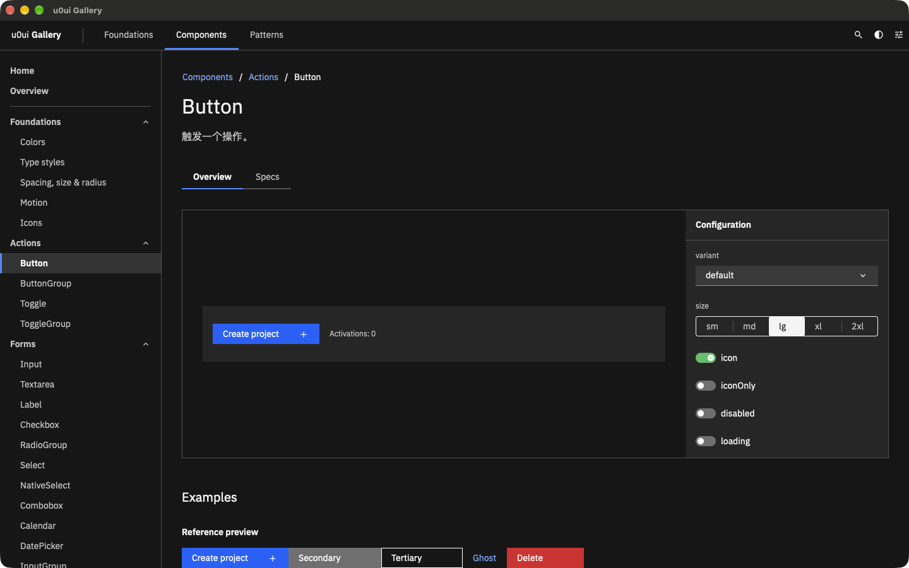

# u0ui

[English](README.md) · **简体中文**

面向 [GPUI](https://www.gpui.rs/) 的 Carbon UI：IBM **Carbon v11** 的视觉，
**shadcn/ui** 风格的组件 API，**Material Symbols Sharp** 图标，构建在
[GPUI Kit](https://github.com/longbridge/gpui-kit) 0.11 之上。

按钮、输入框、下拉选择、菜单、对话框、侧边面板、表格、标签页、侧边导航、图表、聊天气泡等等，
画法与 `@carbon/styles` 一致：默认直角，填充式字段加底线，用分层 token 而不是阴影区分层级，
2px 焦点框，Carbon 的 productive 动效。行为（焦点、键盘、文本编辑、浮层、滚动）由 Kit 负责，
外观由 u0ui 负责。







## 特性

- **Carbon v11 外观**：几何尺寸、各状态颜色和动效取自 Carbon UI 设计参考中编译好的
  `@carbon/styles` CSS；所有 token 都由代码生成，从不手写。
- **四套主题**：White、G10、G90、G100，遵循 Carbon 的分层模型
  （background → layer-01 → layer-02 → layer-03）及其上下文 token；`theme::zone`
  可以让某个区域固定使用一套主题（例如始终深色的页头）。
- **shadcn/ui API**：shadcn 的 66 个组件沿用 shadcn 的名字（`Badge` 即 Carbon 的 Tag，
  `Card` 即 Tile，`Select` 即 Dropdown……），另有 Chat & AI 组；构建器方法与参考的
  `index.d.ts` 一一对应。
- **Material Symbols Sharp** 贯穿始终（字重 400，光学尺寸 24，16/20/24/32px），
  并保留 Carbon 的图标名（`CarbonIcon::Add`、`ChevronDown`……）。
- **桌面密度**：默认紧凑的行高和字段高度，需要时切换为 Carbon 的舒适尺寸；尺寸使用 `rem`，
  缩放时自动重排。
- **减少动效**：位移改为淡入淡出，旋转改为脉冲，闪烁动画停止。
- 内置 **IBM Plex** Sans 与 Mono，并配有 CJK 回退字体。

## 快速开始

Rust 最低版本 1.98。

```toml
[dependencies]
gpui-kit = "0.11"
u0ui = { git = "https://github.com/u0-code/gpui-u0ui" }
```

请使用与 u0ui 相同的 `gpui-kit` 版本，保证 GPUI 和 Kit 只有一份。先初始化 Kit，再初始化
u0ui，并提供 u0ui 的图标资源：

```rust,no_run
use gpui_kit::*;
use u0ui::prelude::*;

struct Hello;

impl Render for Hello {
    fn render(&mut self, _: &mut Window, _: &mut Context<Self>) -> impl IntoElement {
        div()
            .size_full()
            .p(tokens::SPACING_07)
            // 用颜色角色绘制，界面会跟随主题变化。
            .bg(color(ColorRole::Background))
            .text_color(color(ColorRole::TextPrimary))
            .child(Button::new("deploy", "Deploy").icon(CarbonIcon::Launch))
    }
}

fn main() {
    gpui_kit::application()
        .with_assets(u0ui::Assets::new())
        .run(|cx| {
            gpui_kit::init(cx);
            u0ui::init(cx);
            gpui_kit::open_window(WindowOptions::default(), cx, |_, cx| cx.new(|_| Hello))
                .expect("open the window");
        });
}
```

[`crates/u0ui/examples/hello.rs`](crates/u0ui/examples/hello.rs) 是这个示例的完整版，
带计数器和主题开关（`cargo run -p u0ui --example hello`）；`cargo test` 会编译它，
所以它始终可用。组件和 shadcn 一样既可受控也可非受控：传入 `checked`/`value`/`open`
和变更回调，或者传入 `default_*`，让组件自己保存状态。

## 组件

| 分组 | 组件 | 状态 |
| --- | --- | --- |
| Actions | Button、ButtonGroup、Toggle、ToggleGroup | 已完成 |
| Forms | Input、Textarea、Label、Checkbox、RadioGroup、Select、NativeSelect、Combobox、Calendar、DatePicker、InputGroup、Field、InputOTP、Switch、Slider | 已完成 |
| Data display | AspectRatio、Kbd、Separator、Badge、Card、Chart、Avatar、Table、DataTable、CodeBlock、Empty、Item、Typography | 已完成 |
| Feedback | Spinner、Skeleton、Progress、Alert、Toast | 已完成 |
| Navigation | Menubar、Tabs、Accordion、Collapsible、Breadcrumb、Pagination、NavigationMenu、Sidebar | 已完成 |
| Overlays | Dialog、AlertDialog、Sheet、Drawer、Tooltip、Popover、HoverCard、DropdownMenu、ContextMenu、Command | 已完成 |
| Layout | ScrollArea、Resizable、Direction、Carousel | 已完成 |
| Chat & AI | Bubble、Message、Marker、MessageScroller、Attachment、Questionnaire、Trace | 已完成 |
| Carbon · Patterns | 16 个 Carbon 模式（全局页头、表单、对话框、空状态……） | 计划中 |
| T3 · … | T3 Code 模式库的 92 张卡片 | 计划中 |
| Ghost · … | Ghost 模式库的 81 张卡片 | 计划中 |

“已完成”表示已实现、有测试并在 Gallery 中实时展示；对照参考的评审仍在继续，1.0 之前细节可能还会调整。

## Gallery

`crates/gallery` 以 md3.io 的页面结构实时展示每个组件：一个首页，一个带实时缩略图的组件总览，
每个组件页有 **Playground**（真实组件，旁边是配置面板，用开关、内容切换器和下拉选择覆盖每个变体、
尺寸和状态）、参考 **Examples**，部分组件还有 **Specs** 标签页（结构、尺寸和各状态颜色，
直接读取组件自身的外观函数）。页头提供 ⌘K 命令面板、主题（White、G10、G90、G100）和显示设置
（密度、减少动效）。

```sh
cargo run -p u0ui-gallery --release
cargo run -p u0ui-gallery --release -- --page button --theme g100 --density comfortable
# 无界面截图：全部页面，或用 --page 指定一个。
cargo run -p u0ui-gallery --release -- --capture shots --theme g10 --size 1440x900
```

`--page` 接受 `home`、`overview`、`foundations`、`components`、`patterns` 或组件 id
（`--help` 会列出全部）。上面的截图取自运行中的 Gallery，窗口 1440×900（`docs/screenshots/`）。

## 主题、分层与密度

```rust,ignore
theme::set_theme(cx, CarbonTheme::G90);        // 重绘所有窗口，Kit 控件一并更新
let bg = color(ColorRole::Layer01);            // 无需上下文的颜色角色查询
Input::new("name", &state).layer(LayerLevel::Two) // 放在 layer-01 表面上的字段
density::set_density(cx, Density::Comfortable); // Carbon 的 40px 字段、48px 按钮
motion::set_reduced_motion(cx, motion::ReducedMotion::Reduce);
div().child(theme::zone(CarbonTheme::G100, |_, _| header().into_any_element()))
```

- **主题**：`set_theme` 是唯一的写入入口；它同时把 Carbon 投射到 Kit 的主题里，让 Kit 的输入框、
  列表和滚动条保持一致。渲染过程从不修改主题。
- **分层**：绘制上下文 token 的组件接受一个 `LayerLevel`（默认 `One`，即放在 `background` 上）；
  绘制 `layer-0N` 的容器把 `level.next()` 传给子组件。
- **密度**：`Compact`（桌面默认：行高 28/32/36，字段 28/32）或 `Comfortable`（Carbon 原尺寸）。

## 架构

```text
$U0UI_DESIGN_DIR（仓库外） ──u0ui-codegen──▶ 生成的 token、图标、组件描述
u0ui::tokens → theme → typography → motion → icons → density → components
crates/gallery：shell、home、overview、pages、specs、--capture
```

行为交给 Kit，u0ui 在其上绘制 Carbon：每个组件包装已经实现该行为的 Kit 或 Base 元素，
并把外观和几何尺寸写成以状态、尺寸和密度为输入的纯函数，并为之编写测试。分层、关键决策以及
新增组件和 Gallery 页面的步骤见 [docs/ARCHITECTURE.md](docs/ARCHITECTURE.md)，
所有改动遵循的规则见 [AGENTS.md](AGENTS.md)。

## 设计参考

u0ui 实现的是 **Carbon UI** 设计系统参考（以 shadcn/ui API 包装的 Carbon v11；包含 token、
组件说明与预览、`index.d.ts` 和编译好的 `bundle.css`）。它**不在本仓库中**。由它派生的源码已经生成
并提交，所以没有它也能构建：`crates/u0ui/src/generated/{tokens,carbon_icons}.rs` 和
`crates/gallery/src/generated/descriptions.rs`。参考更新时：

```sh
export U0UI_DESIGN_DIR=/path/to/carbon-ui-reference
cargo run -p u0ui-codegen           # 重新生成
cargo run -p u0ui-codegen -- --check # 已提交的生成文件过期时报错
```

## 许可

代码采用 Apache-2.0。随附和派生的资源保留各自的许可：

- **IBM Plex** 字体（`crates/u0ui/assets/fonts`）：SIL Open Font License 1.1。
- **Material Symbols**（通过 `gpui-material-symbols`）：Apache-2.0，Google。
- **Carbon** 设计 token 与样式（`@carbon/themes`、`@carbon/styles`，生成的 token 和组件数值来源于此）：
  Apache-2.0，IBM。

u0ui 与 IBM 无关联，不使用任何 IBM 标志或商标。
